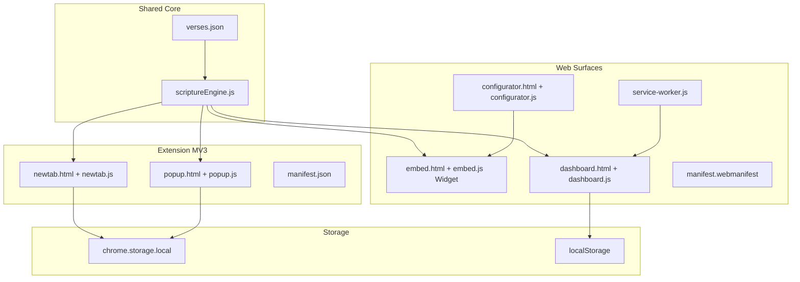

# Design Document: Cross-Platform Scripture & Quiet-Time Suite

## Overview

The Scripture & Quiet-Time Suite is a zero-database, multi-surface scripture application built entirely with Vanilla JavaScript, HTML5, and CSS3. It delivers daily Bible verses, reflections, and meditative prompts through three delivery surfaces that share a single core engine:

1. **Chrome/Edge Extension (Manifest V3)** — overrides the new tab page and provides a popup feed with a focus timer.
2. **Embeddable Web Widget** — a self-contained `<iframe>` card that third-party sites embed with a single snippet.
3. **Responsive PWA Dashboard** — a full-featured, offline-capable web app for reading, browsing, bookmarking, and configuring.

All content originates from a static `verses.json` file bundled with the application. No backend, database, or external API is required at runtime. User preferences (theme, bookmarks) are persisted in browser storage APIs appropriate to each surface.

### Key Design Principles

- **Shared core, surface-specific shells.** The `scriptureEngine.js` module is the single source of truth for all verse retrieval logic. UI shells (extension, widget, dashboard) depend on this module — they never reimplement verse selection.
- **Static-first, no network required.** All data is bundled at build time. The application degrades gracefully to offline from the first load.
- **Progressive enhancement.** The widget and dashboard render correctly without JavaScript for the initial HTML frame; JS enhances them with dynamic content.
- **No-flash theming.** Theme is read from storage synchronously (or via a blocking inline script) before paint, preventing a flash of unstyled content (FOUC).

---

## Architecture



### Directory Layout

```
/
├── shared/
│   ├── scriptureEngine.js       # Core verse logic (shared across all surfaces)
│   └── verses.json              # Static verse data store
│
├── extension/
│   ├── manifest.json            # MV3 manifest
│   ├── newtab.html
│   ├── newtab.js
│   ├── popup.html
│   ├── popup.js
│   └── styles/
│       ├── newtab.css
│       └── popup.css
│
├── web/
│   ├── embed.html               # Self-contained widget
│   ├── embed.js
│   ├── configurator.html
│   ├── configurator.js
│   ├── dashboard.html
│   ├── dashboard.js
│   ├── service-worker.js
│   ├── manifest.webmanifest
│   └── styles/
│       ├── base.css             # CSS custom properties / tokens
│       ├── widget.css
│       ├── configurator.css
│       └── dashboard.css
│
└── icons/                       # Shared icon assets
```

---

## Components and Interfaces

### 1. Scripture Engine (`scriptureEngine.js`)

The engine is a pure ES module that imports `verses.json` at load time and exposes three functions. It has no side effects and no I/O beyond the initial JSON parse.

```js
// Public API
export function getDailyVerse(): VerseEntry | ErrorObject
export function getRandomVerse(category?: string): VerseEntry | ErrorObject
export function getQuietTimePrompt(): string | ErrorObject

// Internal helpers (not exported)
function getDayOfYear(date: Date): number        // 1–365
function findNearestVerse(day: number): VerseEntry
function pickRandom(arr: VerseEntry[]): VerseEntry
```

**getDailyVerse()** — Computes `DayOfYear` from `new Date()` (local clock only). Finds the entry where `dayOfYear === DayOfYear`. If no exact match, wraps modularly and returns the nearest entry.

**getRandomVerse(category?)** — If `category` is provided and no entries exist for it, returns `{ error: true, message: "No entries for category: <category>" }`. Otherwise selects using `Math.random()`.

**getQuietTimePrompt()** — Delegates to `getDailyVerse()` and extracts the `quietTimePrompt` field.

**Error contract:** All three functions return either a valid `VerseEntry` or an `ErrorObject` `{ error: true, message: string }`. Callers check `result.error` before rendering.

---

### 2. Extension — New Tab (`newtab.html` / `newtab.js`)

Lifecycle:
1. Inline `<script>` in `<head>` reads theme from `chrome.storage.local` synchronously via callback and sets `document.documentElement.dataset.theme` before body renders.
2. On `DOMContentLoaded`, calls `getDailyVerse()` and populates the verse card.
3. "Copy to Clipboard" → `navigator.clipboard.writeText(\`${reference} — ${text}\`)`.
4. "Random Verse" → calls `getRandomVerse()`, replaces card content in-place (no reload).
5. "Toggle Theme" → flips `data-theme`, writes to `chrome.storage.local`.

**No additional permissions** beyond `storage` are requested. Clipboard API is available in MV3 new tab pages without extra permissions.

---

### 3. Extension — Popup (`popup.html` / `popup.js`)

The popup renders in a `<div>` constrained to `max-width: 400px; max-height: 600px` in CSS. It shows `reference`, `text`, and `quietTimePrompt` only (compact layout).

**Focus Timer** — Implemented as a plain `setInterval` (1-second tick) stored in a module-level variable. The popup window keeps the interval alive for as long as it stays open.

```js
let timerInterval = null;
let remaining = 120;

function startTimer() { /* sets interval */ }
function resetTimer() { remaining = 120; clearInterval(timerInterval); updateDisplay(); }
```

When `remaining` reaches 0, the interval is cleared and a completion message replaces the countdown display.

---

### 4. Embeddable Widget (`embed.html` / `embed.js`)

The widget reads query parameters from `location.search` on load. Parsing is done with `URLSearchParams`.

| Param | Values | Default |
|-------|--------|---------|
| `theme` | `light`, `dark` | `light` |
| `category` | any category string | (none — uses full store) |
| `mode` | `daily`, `random` | `daily` |

On load, `embed.js`:
1. Parses params.
2. Sets `data-theme` on the root element.
3. Calls `getDailyVerse()` or `getRandomVerse(category)` based on `mode`.
4. Renders the verse card.

**Performance:** The embed has zero network calls. The `<script>` tag is deferred; the iframe renders a placeholder shell in pure HTML/CSS (sub-100ms) and JS populates it on `DOMContentLoaded`.

---

### 5. Widget Configurator (`configurator.html` / `configurator.js`)

The Configurator maintains a local `config` object:

```js
const config = { theme: 'light', category: '', mode: 'daily' };
```

On any control change, `updatePreview()` re-renders the live preview `<iframe>` by setting its `src` to `embed.html?theme=...&category=...&mode=...`. This is a full `src` swap, which triggers the embed to re-initialize — keeping the preview always in sync without complex cross-frame messaging.

**buildEmbedCode()** returns a string like:
```html
<iframe src="https://example.com/embed.html?theme=light&category=hope&mode=daily" 
        width="400" height="250" frameborder="0"></iframe>
```

Clipboard copy uses `navigator.clipboard.writeText()`. The confirmation message is shown by toggling a `data-copied="true"` attribute on the button, which CSS transitions to a ✓ state; the attribute is removed after 2 seconds.

---

### 6. PWA Dashboard (`dashboard.html` / `dashboard.js`)

The Dashboard is a single-page application with three views managed via CSS class toggling (no router library):

| View | ID | Content |
|------|-----|---------|
| Daily | `#view-daily` | Daily verse full display |
| Catalog | `#view-catalog` | All verses grouped by category |
| Bookmarks | `#view-bookmarks` | Bookmarked verses |
| Configurator | `#view-configurator` | Embedded configurator UI |

**Navigation:** A `<nav>` element contains both a desktop nav bar and a mobile hamburger menu / bottom bar. CSS `@media (max-width: 768px)` hides the desktop nav and shows the mobile nav. The minimum supported width is 320px, ensured by `min-width: 320px` on the root and fluid grid layouts.

**Bookmarks:**
- Stored in `localStorage` under key `sqts_bookmarks` as a JSON array of `id` strings.
- Toggle logic ensures no duplicates: if `ids.includes(id)` → remove, else → push.
- Loaded once on startup and kept in memory; written back to `localStorage` on every change.

**Theme:**
- Stored in `localStorage` under key `sqts_theme`.
- Applied by an inline `<script>` block at the top of `<body>` before any CSS paint.

---

### 7. Service Worker (`service-worker.js`)

Uses a **cache-first** strategy with a versioned cache name (`sqts-v1`). On `install`, all static assets are pre-cached:

```js
const CACHE_NAME = 'sqts-v1';
const ASSETS = [
  '/', '/dashboard.html', '/embed.html', '/configurator.html',
  '/styles/base.css', '/styles/dashboard.css', '/styles/widget.css',
  '/dashboard.js', '/embed.js', '/configurator.js',
  '/shared/scriptureEngine.js', '/shared/verses.json',
  '/manifest.webmanifest', '/icons/icon-192.png', '/icons/icon-512.png'
];
```

On `activate`, old caches are deleted. On `fetch`, assets are served from cache first; a network miss triggers an update to cache for next time.

**Update detection:** When a new service worker is waiting, a `message` of type `'SW_UPDATE_AVAILABLE'` is posted to all clients, which the dashboard JS handles by showing a "Refresh for new content" banner.

---

## Data Models

### VerseEntry (verses.json schema)

```ts
interface VerseEntry {
  id: string;               // Unique identifier, e.g. "v001"
  dayOfYear: number;        // Integer 1–365 inclusive
  reference: string;        // e.g. "John 3:16"
  text: string;             // Verse text body
  translation: string;      // e.g. "NIV", "ESV", "KJV"
  reflection: string;       // Short commentary
  quietTimePrompt: string;  // Meditative question/challenge, ≥10 chars
  category: string;         // One of: "hope" | "peace" | "faith" | "gratitude" | ...
}
```

**verses.json top-level structure:**

```json
{
  "verses": [
    {
      "id": "v001",
      "dayOfYear": 1,
      "reference": "John 3:16",
      "text": "For God so loved the world...",
      "translation": "NIV",
      "reflection": "A foundational verse on salvation.",
      "quietTimePrompt": "How does God's love shape the way you love others today?",
      "category": "hope"
    }
  ]
}
```

**Constraints enforced at load time by the engine:**
- `verses` array length: 15–365
- `id` uniqueness: validated by building a `Set` and comparing sizes
- `dayOfYear` range: 1–365
- `category` membership: must be in the defined allowed set
- `quietTimePrompt` length: ≥ 10 characters

### ErrorObject

```ts
interface ErrorObject {
  error: true;
  message: string;  // Human-readable description
}
```

### StorageKeys

| Surface | Key | Type | Description |
|---------|-----|------|-------------|
| Extension | `sqts_theme` | `"light" \| "dark"` | Stored in `chrome.storage.local` |
| Dashboard | `sqts_theme` | `"light" \| "dark"` | Stored in `localStorage` |
| Dashboard | `sqts_bookmarks` | `string[]` (verse IDs) | Stored in `localStorage` |

### Web App Manifest (`manifest.webmanifest`)

```json
{
  "name": "Scripture & Quiet-Time Suite",
  "short_name": "ScriptureApp",
  "start_url": "/dashboard.html",
  "display": "standalone",
  "background_color": "#faf9f6",
  "theme_color": "#4a7c59",
  "icons": [
    { "src": "/icons/icon-192.png", "sizes": "192x192", "type": "image/png" },
    { "src": "/icons/icon-512.png", "sizes": "512x512", "type": "image/png" }
  ]
}
```

---

## Correctness Properties

*A property is a characteristic or behavior that should hold true across all valid executions of a system — essentially, a formal statement about what the system should do. Properties serve as the bridge between human-readable specifications and machine-verifiable correctness guarantees.*


### Property 1: JSON Round-Trip Preserves Verse Data

*For any* verse entry in the Verses_Store, serializing the entry to a JSON string with `JSON.stringify` and then parsing it back with `JSON.parse` shall produce a value that is deeply equal to the original entry, with all fields (`id`, `dayOfYear`, `reference`, `text`, `translation`, `reflection`, `quietTimePrompt`, `category`) intact and unchanged.

**Validates: Requirements 1.7**

---

### Property 2: DayOfYear Always Produces a Value in 1–365

*For any* `Date` object representing any calendar date (past, present, or future), the internal `getDayOfYear(date)` function shall return an integer `n` such that `1 ≤ n ≤ 365`.

**Validates: Requirements 2.1**

---

### Property 3: getDailyVerse Always Returns a Valid Verse Entry

*For any* day of year value (1–365), calling `getDailyVerse()` with that date context shall return a valid `VerseEntry` object — never an error object. When an exact `dayOfYear` match exists in the store, the returned entry's `dayOfYear` shall equal the requested day. When no exact match exists, the returned entry shall be the one whose `dayOfYear` is modularly nearest to the requested day, and the returned entry shall still be a member of the Verses_Store.

**Validates: Requirements 2.2, 2.3**

---

### Property 4: getRandomVerse With Category Returns Only Matching Verses

*For any* valid category string present in the Verses_Store, every call to `getRandomVerse(category)` shall return a `VerseEntry` whose `category` field strictly equals the provided category string. When called without a category argument, every call shall return a `VerseEntry` that is a member of the full Verses_Store.

**Validates: Requirements 3.1, 3.2**

---

### Property 5: getRandomVerse With Unknown Category Returns an Error Object

*For any* string that does not match any `category` value present in the Verses_Store, calling `getRandomVerse(unknownCategory)` shall return an object with `error: true` and a `message` field that is a non-empty string describing the failure.

**Validates: Requirements 3.3**

---

### Property 6: QuietTimePrompt Is Always a Substantive String

*For any* verse entry in the Verses_Store, the `quietTimePrompt` field shall be a string with a length of at least 10 characters. Additionally, `getQuietTimePrompt()` called in any date context shall return a string equal to the `quietTimePrompt` field of the `VerseEntry` returned by `getDailyVerse()` for that same date context.

**Validates: Requirements 4.1, 4.2**

---

### Property 7: Verse Card Rendering Preserves All Required Fields

*For any* `VerseEntry` object, any render function that produces an HTML string or DOM fragment for a verse card (new tab card, popup card, or dashboard daily view) shall produce output that contains the entry's `reference`, `text`, `translation` (where applicable to the surface), `reflection` (where applicable), and `quietTimePrompt` as visible content. No required field shall be silently dropped or left empty in the rendered output.

**Validates: Requirements 5.1, 6.1, 9.1**

---

### Property 8: Clipboard Format Contains Reference and Text

*For any* `reference` string and `text` string, the formatted clipboard string produced for "Copy to Clipboard" shall contain both the `reference` substring and the `text` substring.

**Validates: Requirements 5.4**

---

### Property 9: Theme Storage Round-Trip

*For any* theme value (`"light"` or `"dark"`), writing that theme to the appropriate storage medium (either `chrome.storage.local` for the extension or `localStorage` for the dashboard) and then reading it back shall return the same theme value. The two storage mediums shall operate independently, meaning a theme value written to extension storage shall not affect the value in dashboard storage, and vice versa.

**Validates: Requirements 5.6, 5.7, 11.1, 11.3, 11.7**

---

### Property 10: Embed Code Contains All Configuration Parameters

*For any* configuration object with fields `{ theme, category, mode }`, the `buildEmbedCode(config)` function shall return a string that contains a valid HTML `<iframe>` tag whose `src` attribute includes `theme=<value>`, `category=<value>`, and `mode=<value>` as query parameters reflecting the exact values from the config object.

**Validates: Requirements 8.3, 8.4**

---

### Property 11: Category Grouping and Filtering Correctness

*For any* array of `VerseEntry` objects:
- `groupByCategory(entries)` shall return an object where every entry stored under a given key has a `category` field equal to that key, and no entry appears under a key that does not match its `category`.
- `filterByCategory(entries, category)` shall return only those entries whose `category` field equals the provided `category` string, and every entry in the source array with a matching `category` shall appear in the result.

**Validates: Requirements 7.5, 9.2, 9.3**

---

### Property 12: Service Worker Cache Serves All Assets Offline

*For any* URL that is included in the service worker's `ASSETS` pre-cache list, when the network is unavailable, a `fetch` event for that URL shall be handled by the service worker and shall return a non-null `Response` object retrieved from the cache rather than from the network.

**Validates: Requirements 10.2**

---

### Property 13: Bookmark Toggle Round-Trip

*For any* verse `id` string:
- After calling `addBookmark(id)` (or `toggleBookmark(id)` on an un-bookmarked id), the bookmarks list retrieved from `localStorage` shall contain that `id`.
- After calling `removeBookmark(id)` (or `toggleBookmark(id)` on an already-bookmarked id), the bookmarks list retrieved from `localStorage` shall not contain that `id`.

**Validates: Requirements 12.1, 12.2, 12.4**

---

### Property 14: Bookmark List Contains No Duplicates

*For any* sequence of `addBookmark` or `toggleBookmark` operations applied to the bookmarks list, the resulting list shall contain no duplicate `id` values at any point. Formally, `bookmarkList.length === new Set(bookmarkList).size` shall hold after every operation.

**Validates: Requirements 12.5**

---

### Property 15: getBookmarkedVerses Returns Exactly the Bookmarked Entries

*For any* array of verse `id` strings (the bookmarks list) and any array of `VerseEntry` objects (the full store), `getBookmarkedVerses(ids, entries)` shall return exactly those entries whose `id` is present in the `ids` array — no more, no fewer. An `id` in the bookmarks list that has no matching entry in the store shall be silently ignored.

**Validates: Requirements 12.3**

---

## Error Handling

### Scripture Engine Errors

All engine functions return an `ErrorObject` rather than throwing. Callers always check `result.error` before accessing verse fields.

| Scenario | Error message |
|----------|--------------|
| verses.json fails to parse | `"Failed to parse verses.json: <parse error detail>"` |
| `getRandomVerse` called with unknown category | `"No entries for category: <category>"` |
| Verses_Store is empty after parse | `"Verses_Store contains no entries"` |
| Verse entry missing required field | `"Invalid entry at index <n>: missing field '<field>'"` |

### UI Surface Error Handling

- **Extension (new tab / popup):** If the engine returns an error, display a fallback card with a hard-coded default verse and the error message shown in the browser console (not to the user).
- **Widget:** If the engine returns an error, render a simple "Scripture unavailable" message inside the iframe card — no broken layout.
- **Dashboard:** Toast/banner notification for errors; the rest of the UI remains functional.

### Service Worker Error Handling

- If a resource is not in cache and the network is unavailable, the service worker returns the cached `offline.html` fallback page (for navigation requests) or a generic opaque response (for sub-resource requests).

---

## Testing Strategy

### Unit Tests

Focused on specific behaviors and edge cases. Written with a standard test runner (e.g., Vitest or Jest).

- **scriptureEngine:** exact match retrieval, fallback/modular-wrap retrieval, invalid category error, parse failure, quietTimePrompt extraction.
- **Timer logic:** countdown tick, reset, completion event.
- **Theme defaults:** no stored value → defaults to `"light"` for both extension and dashboard.
- **Bookmark operations:** add, remove, duplicate prevention, load from storage.
- **Configurator:** embed code generation with specific config values, confirmation message timing.

### Property-Based Tests

Each property corresponds to one property-based test, run with a minimum of **100 iterations**.

Recommended library: **fast-check** (TypeScript/JavaScript), which integrates with Vitest and Jest.

Tag format for each test:

```js
// Feature: scripture-quiet-time-suite, Property 1: JSON Round-Trip Preserves Verse Data
test.prop([fc.record({ id: fc.string(), dayOfYear: fc.integer({min:1,max:365}), ... })])(
  'verse entry survives JSON round-trip',
  (entry) => { expect(JSON.parse(JSON.stringify(entry))).toEqual(entry); }
);
```

| Property | Test Description |
|----------|-----------------|
| P1 | Verse JSON round-trip — any entry in, same entry out |
| P2 | getDayOfYear in range 1–365 for any date |
| P3 | getDailyVerse always returns a valid VerseEntry |
| P4 | getRandomVerse(category) result always matches that category |
| P5 | Unknown category always returns error object |
| P6 | quietTimePrompt always ≥ 10 chars; getQuietTimePrompt matches daily verse |
| P7 | Render functions preserve all required verse fields |
| P8 | Clipboard format contains reference and text |
| P9 | Theme storage read-after-write returns same value |
| P10 | buildEmbedCode includes all config params |
| P11 | Category group/filter correctness for any entry array |
| P12 | Service worker cache serves offline for any cached URL |
| P13 | Bookmark toggle add/remove round-trip |
| P14 | Bookmark list never has duplicates after any operations |
| P15 | getBookmarkedVerses returns exactly the bookmarked entries |

### Integration / Smoke Tests

- Manifest V3 permissions validation (only `storage`).
- Service worker installs and caches all ASSETS.
- Web App Manifest contains required fields.
- Dashboard renders at 320px viewport without horizontal scroll (Playwright/Cypress snapshot).
- Widget renders within 100ms (benchmark with `performance.now()`).
- Configurator confirmation message appears within 500ms.

### Accessibility

- Keyboard navigation for all interactive elements (buttons, nav).
- ARIA labels on icon-only buttons (Copy, Bookmark, Toggle Theme).
- Minimum contrast ratio 4.5:1 for all text in both themes (tested via axe-core).
- Focus indicators visible in both themes.
